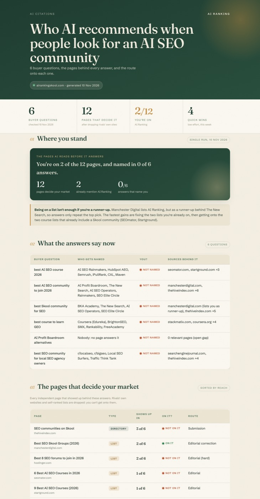

# AI Citation Finder

Find the pages that ChatGPT, Google AI Overviews and Perplexity read before they recommend someone in your market, see which ones you're on, and get a ready-to-send action for every page you're missing from.

A free Claude skill from the [AI Ranking community](https://skool.com/ai-ranking).



## Why

AI assistants rarely invent a recommendation. When someone asks "best plumber in Austin" or "best AI SEO course", the answer repeats a small set of pages: independent "best of" lists, directories, review sites, Reddit threads and YouTube videos. In most markets that's 5 to 30 pages. Get onto them and you get into the answer.

An AI visibility tool tells you that you're not being named. This skill tells you **which pages make AI name someone else, and how to get onto each one.**

## What it does

1. **Writes 5 to 8 buyer questions** (the ones people ask when they're ready to choose) and waits for your OK.
2. **Collects the sources behind each answer** with Claude's web search, or with real ChatGPT answers if you connect DataForSEO.
3. **Cleans the list:** drops competitors' own websites, lists that rank themselves first, stale pages and dead pages.
4. **Checks whether you're on each page,** and only marks "on it" when it can quote the line.
5. **Finds the route onto each page:** editorial (the author and a public contact), submission form, listing to claim, reviews, paid, community thread, or a page or video you should make yourself.
6. **Drafts the work:** outreach emails under 120 words, submission form fields and helpful forum replies. If Gmail is connected, emails go in as drafts. **Nothing is ever sent or posted for you.**
7. **Builds the report:** a single HTML file with what each answer says now, the pages that decide your market, and a fastest-wins-first action list.

## Install

**Claude desktop app or claude.ai:** download [ai-citation-finder.zip](https://github.com/NicoSKOOL/ai-citation-finder/releases/latest/download/ai-citation-finder.zip) (don't unzip it), then go to Settings > Capabilities > Skills > Upload skill. Turn on web search.

**Claude Code:**

```bash
git clone https://github.com/NicoSKOOL/ai-citation-finder ~/.claude/skills/ai-citation-finder
```

## Use

> Find the pages AI cites for my business. I'm [business], we sell [service] in [city]. Competitors: [a, b, c].

If you've used the other AI Ranking skills, it reads your `site-brief.md` and the gaps from `ai-visibility-checker` automatically.

## Data

- **Free:** Claude's web search. Works for any business, any country.
- **Better (optional):** the [DataForSEO](https://app.dataforseo.com/?aff=182182) connector (`https://mcp.dataforseo.com/mcp`) adds the URLs ChatGPT itself cites. This is pay as you go, at a few cents per run.
- **Optional:** the Gmail connector, so outreach goes straight into your drafts.

## Good to know

- AI answers change between runs. Treat one run as a snapshot, re-run monthly, and watch how many pages you're on.
- The skill never guesses an email address, a price or a date. Anything it can't verify is marked `[CONFIRM]`.
- No review gating, fake reviews or promotional forum posts. Communities get a genuinely helpful answer, or "skip".


## License

MIT

---

## Part of AI Ranking

This is one of the free tools from **AI Ranking**, the community where we learn how to get businesses found on Google and recommended by AI (ChatGPT, Google AI Overviews, Perplexity).

**Free community:** [skool.com/ai-ranking-free](https://skool.com/ai-ranking-free)  
Every free skill in one place, with setup guides.

**Premium:** [skool.com/ai-ranking](https://skool.com/ai-ranking)  
For when you want help, not just tools:
- Support when a skill or a site gets stuck
- 1-1 sessions
- Live Q&A calls
- The full training on how to rank in AI search

Built by [Nico Gorrono](https://airankingskool.com/about/)
